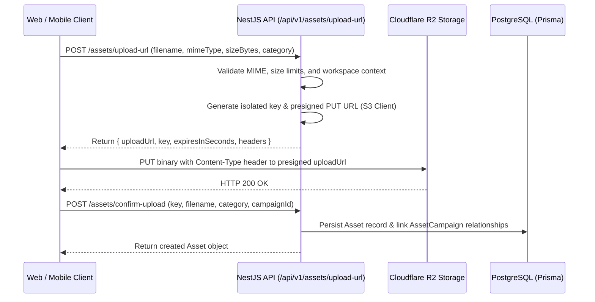

# CORVIIN HUB — Operational Services Guide (Phase 7)

## Overview

This guide provides operational runbooks, architecture details, and administrative procedures for CORVIIN HUB's Phase 7 operational services:
- **Cloudflare R2 Object Storage & Asset Management**
- **In-App Notifications & Preference Filtering**
- **Activity Feed & Security-Redacted Audit Trail**
- **Health Monitoring & Disaster Recovery (PostgreSQL & R2)**

---

## 1. Cloudflare R2 Object Storage Integration

### Architecture & Boundaries
- CORVIIN HUB utilizes Cloudflare R2 as its S3-compatible object storage provider for private documents, images, video assets, and meeting attachments.
- **Private Access Rule**: The R2 bucket is strictly private. Public bucket access is disabled.
- **Credential Protection**: R2 credentials (`R2_ACCESS_KEY_ID`, `R2_SECRET_ACCESS_KEY`, `R2_ENDPOINT`) are stored only in server-side environment variables and are **never** exposed to frontend web, mobile/Capacitor, or git repositories.
- **Backend-Authorized URLs**: All uploads and downloads occur via backend-authorized, time-limited presigned URLs (default 900 seconds / 15 minutes).

### Storage Key Isolation
Storage keys are strictly scoped by workspace to guarantee tenant data isolation:
```
workspaces/{workspaceId}/assets/{uniqueId}-{sanitizedFilename}
```
Example:
`workspaces/ws-tech-0001-0000-000000000001/assets/clx891ab0000-q2-presentation.pdf`

### Supported MIME Types & File Validation
Enforced at the client uploader and NestJS API boundary:
- **Images**: `image/jpeg`, `image/png`, `image/webp`, `image/svg+xml`, `image/gif` (max 25 MB)
- **Documents**: `application/pdf`, `text/plain`, `text/csv`, `application/vnd.openxmlformats-officedocument.wordprocessingml.document` (docx), `application/vnd.openxmlformats-officedocument.spreadsheetml.sheet` (xlsx) (max 50 MB)
- **Audio**: `audio/mpeg`, `audio/wav`, `audio/mp4` (max 100 MB)
- **Video**: `video/mp4`, `video/webm`, `video/quicktime` (max 500 MB)
- **Disallowed & Blocked**: Executables (`.exe`, `.bat`, `.sh`, `.cmd`, `.msi`), script files, and unauthorized binary formats are rejected with HTTP 400.

### Direct Presigned Upload Flow


### Multi-Campaign Linking & Non-Destructive Unlinking
- An asset binary in R2 can be linked to multiple campaigns without duplicating storage bytes using the `AssetCampaign` join table.
- Unlinking an asset from a campaign deletes the association record in `AssetCampaign`; the underlying `Asset` metadata and R2 binary are retained.
- Deleting an asset requires explicit permissions and triggers a soft/hard deletion workflow that cleans up R2 storage.

---

## 2. In-App Notifications & Preference Filtering

### Event Foundation vs. In-App Notifications
- **Events & Audit Trail**: System-level, immutable audit log (`ActivityEvent` table) recording what happened, actor context, workspace, and entity metadata.
- **In-App Notifications**: User-facing notification records (`Notification` table) delivered to specific profile recipients.

### Deduplication Window
To prevent notification storms from rapid automated or user actions:
- Identical notifications (`recipientId` + `type` + `entityId`) within a **5-minute window** are deduplicated and suppressed.

### Notification Categories & User Preferences
Users can customize which notification categories they receive in **Settings > Notifications**:
| Setting Key | Covered Notification Types | Default |
|---|---|---|
| `taskAssignments` | `TASK_ASSIGNED` | Enabled (`true`) |
| `overdueAlerts` | `TASK_OVERDUE`, `CRM_FOLLOW_UP_DUE` | Enabled (`true`) |
| `deadlineReminders` | `TASK_DUE_SOON`, `CAMPAIGN_DEADLINE` | Enabled (`true`) |
| `campaignMilestones` | `CAMPAIGN_REVIEW_PENDING`, `APPROVAL_STATUS` | Enabled (`true`) |
| `meetingReminders` | `MEETING_APPROACHING`, `MEETING_RESCHEDULED` | Enabled (`true`) |
| `inAppChannel` | Master switch for all in-app notifications | Enabled (`true`) |

If a recipient has disabled a specific category, the system suppresses notification creation for that user while still logging the audit event for compliance.

---

## 3. Security Redaction & Activity Feeds

### Strict Audit Redaction Policy
When events are logged into the audit trail or displayed in activity feeds, the `NotificationsService.sanitizeAuditValues()` engine automatically scrubs:
- Passwords (`password`, `currentPassword`, `newPassword`)
- Access keys & tokens (`token`, `secret`, `accessKey`, `auth`, `credential`, `apiKey`)
- Presigned URLs containing access keys, signatures, or query tokens (`*X-Amz-Signature*`, `*X-Amz-Credential*`)
- Scrubbed values are replaced with `[REDACTED]`.

---

## 4. Operational Monitoring & Health Checks

### Storage Health API
Endpoint: `GET /api/v1/storage/health`  
Public operational status check returning storage provider status:
```json
{
  "status": "ok",
  "data": {
    "provider": "r2",
    "configured": true,
    "bucketName": "corviin-hub-assets",
    "status": "ready"
  }
}
```
*Note: In local development without Cloudflare credentials, the provider automatically falls back to `mock` mode with full logging.*

### Transient Network Retry Strategy
All storage operations (`getPresignedUploadUrl`, `getPresignedDownloadUrl`, `deleteObject`) implement automatic exponential backoff retry:
- Initial delay: 250ms
- Backoff multiplier: 2x
- Max retries: 3 attempts
- Non-retryable errors (e.g. 403 Forbidden, 400 Bad Request) fail immediately with clear domain errors.

---

## 5. Backup & Disaster Recovery Procedures

### PostgreSQL Database (Supabase / Local)
1. **Automated Daily Backups**: Managed by Supabase with point-in-time recovery (PITR).
2. **Manual Snapshot Procedure**:
   ```bash
   pg_dump -h <host> -p <port> -U <user> -d <dbname> -F c -b -v -f "corviin_backup_$(date +%Y%m%d_%H%M%S).dump"
   ```
3. **Database Restore Procedure**:
   ```bash
   pg_restore -h <host> -p <port> -U <user> -d <dbname> -v -c "corviin_backup_<timestamp>.dump"
   ```

### Cloudflare R2 Object Storage
1. **Bucket Versioning**: Enable Object Versioning in Cloudflare R2 dashboard under `corviin-hub-assets > Settings > Object Versioning` to protect against accidental deletion or overwrite.
2. **Replication**: Configure cross-region bucket replication for mission-critical assets.
3. **Disaster Recovery Synchronization**:
   Use the AWS S3 CLI with R2 endpoint:
   ```bash
   aws s3 sync s3://corviin-hub-assets s3://corviin-hub-assets-backup \
     --endpoint-url https://<cloudflare-account-id>.r2.cloudflarestorage.com
   ```

---

## 6. Troubleshooting Common Issues

### Issue 1: "Could not load profiles" / "Unable to connect to API"
- **Cause**: Backend NestJS process on port 3001 is either stopped, restarting, or local PostgreSQL is unreachable.
- **Resolution**:
  1. Check PostgreSQL service: ensure port `5433` (or default `5432`) is active.
  2. Start NestJS API: `npm -w apps/api run dev` (or `node apps/api/dist/main.js`).
  3. Verify API health: `GET http://localhost:3001/api/v1/profiles`.

### Issue 2: Blank Screen on `http://localhost:5173`
- **Cause**: Client-side JavaScript reference error (e.g. Node `process.env` accessed in Vite ESM bundle) or corrupt state in browser storage.
- **Resolution**:
  1. Error Boundary is active in `apps/web/src/app/App.tsx`. Click **Reset Session** or clear `localStorage.removeItem('corviin-hub-state')`.
  2. In Vite configuration, `define: { 'process.env': {} }` guarantees `process.env` is safely polyfilled.
  3. Hard refresh the browser (`Ctrl + F5` or `Cmd + Shift + R`).

